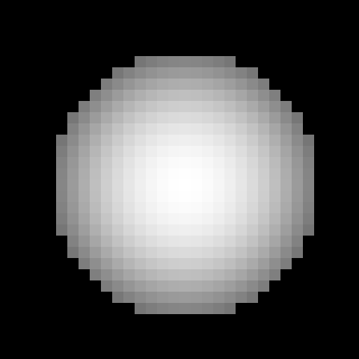
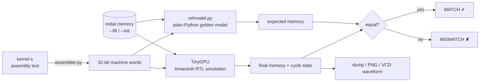
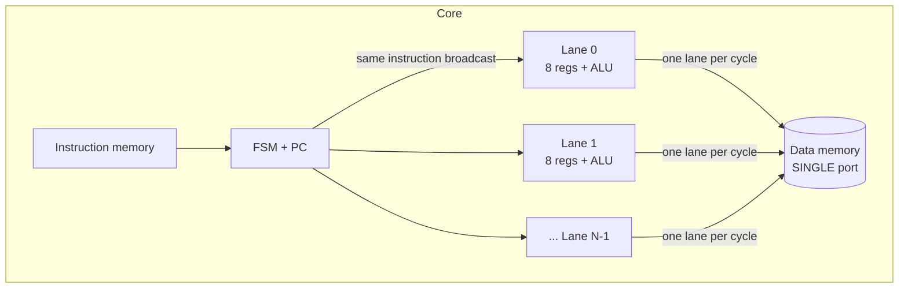
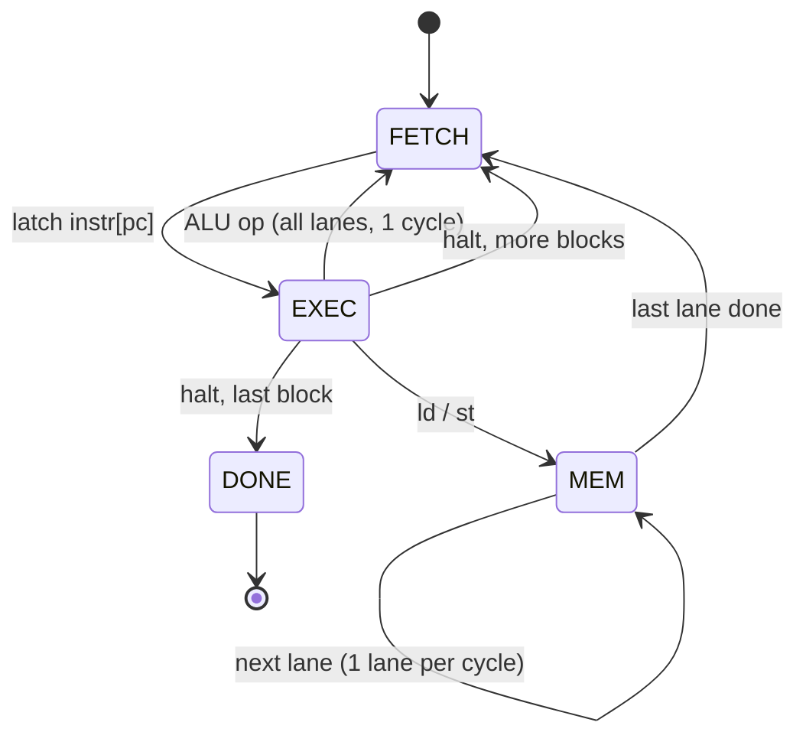

# tiny-gpu

A tiny **SIMT GPU core** written in Python ([Amaranth HDL](https://amaranth-lang.org)) and simulated
cycle-by-cycle on a normal laptop. You write small assembly programs ("kernels"), the simulated
hardware runs them on many threads in parallel, and you inspect memory, cycle counts, and waveforms.

No FPGA, no Verilog toolchain, no GPU needed. Just `pip install`.

| `gradient.s` | `circle.s` | `checker.s` |
|:-:|:-:|:-:|
|  |  |  |

*Each pixel above was computed by one hardware thread running the kernel in `kernels/`.*

---

## Why this exists

A GPU is a machine that runs **the same program on thousands of threads at once**, each thread
working on different data. This project is the smallest honest version of that idea, so you can
see every moving part:

- how threads get an identity (`tid`)
- how one instruction stream drives many lanes at once (SIMT)
- why memory, not math, ends up being the bottleneck
- how hardware gets verified against a software reference

---

## How it works (the flow)



**Verification idea:** `refmodel.py` runs each thread one at a time in ordinary Python.
The hardware runs 8 threads in lockstep. If both produce identical memory, the hardware is correct
for that program. Every run of `run_asm.py` does this check for you.

### The hardware

One core, `N` lanes (default 8). All lanes execute the **same instruction** each step, but each
lane has its **own 8 registers** and its own thread id.



Threads run in **blocks** of `N`. With 1024 threads and 8 lanes, the core runs the program
128 times back to back; in block `b`, lane `l` has `tid = b*N + l`.

The control FSM:



Because data memory has **one port**, a `ld`/`st` takes `N` cycles (one per lane) while an ALU
op takes 1. That is deliberate: memory cost is visible in the stats.

**Cycle formula** (straight-line programs, `halt` counted as an instruction):

```
cycles = blocks × ( 2 × instrs + mem_ops × lanes )
```

Example: `vecadd` = 2 blocks × (2×6 + 3×8) = **72**.

---

## Install

Python 3.10+ (tested with Amaranth 0.5).

```bash
git clone https://github.com/Vidyu8/tiny-gpu.git && cd tiny-gpu
python -m venv .venv
# Windows PowerShell:  .venv\Scripts\Activate.ps1     (if blocked: Set-ExecutionPolicy -Scope Process Bypass)
# macOS/Linux:         source .venv/bin/activate
pip install -r requirements.txt
```

## Quick start

```bash
python -m pytest -q                      # 10 tests, ~20 s
python run_kernel.py circle              # -> out/circle.png
python run_kernel.py circle --lanes 16   # 5376 -> 3200 cycles: more lanes help, memory doesn't shrink
python run_kernel.py vecadd              # prints C = A + B
```

---

## Run your own program

### 1. Mental model: write what ONE thread does

A kernel is the program for **a single thread**. The only thing that tells threads apart is `tid`.
So "process element `i`" becomes: get `tid`, use it as the index.

`my.s` (SAXPY: `y[i] = 3*x[i] + y[i]`, with `x` at address 0 and `y` at address 16):

```asm
tid r1              ; r1 = my thread id = my element index
ld  r2, [r1 + 0]    ; r2 = x[tid]
ld  r3, [r1 + 16]   ; r3 = y[tid]
ldi r4, 3
mul r2, r2, r4      ; 3 * x
add r3, r3, r2      ; + y
st  [r1 + 16], r3   ; y[tid] = result
halt                ; every kernel must end with halt
```

### 2. Run it

```bash
python run_asm.py my.s --threads 16 --fill 0:16:i --fill 16:16:100 --dump 16:16
```

`--fill 0:16:i` means: preload addresses 0..15 with the Python expression `i` (so `x = 0,1,2,...`).
`--fill 16:16:100` preloads `y` with 100 everywhere.

### 3. Read the output

```
--- program (8 instrs) ---          <- disassembly: check the assembler did what you meant
  0: 06000000  tid   rd=r1 ...
  ...
--- stats ---
{'cycles': 80, 'instrs': 16, 'mem_cycles': 48, ...} | mem-bound: 60% of cycles
golden model: MATCH                  <- hardware == reference
--- mem[16:32] ---
   16:   100   103   106   109 ...   <- y[i] = 3*i + 100
```

### `run_asm.py` options

| Flag | Meaning |
|---|---|
| `--threads N` | total threads (**required**, must be a multiple of `--lanes`) |
| `--lanes N` | parallel lanes in the core (default 8) |
| `--depth N` | data memory size in 16-bit words (default 2048) |
| `--fill ADDR:COUNT:EXPR` | preload `COUNT` words from `ADDR`; `EXPR` is Python in `i` (`i*i`, `i%4`, `255-i`) |
| `--init ADDR=v,v,...` | preload literal values |
| `--dump ADDR:COUNT` | print a memory range (repeatable). Default: first 64 words |
| `--image WxH[@BASE]` | save memory as a grayscale PNG in `out/` (`@BASE` = start address) |
| `--vcd` | write `out/<name>.vcd` waveform (open with [GTKWave](https://gtkwave.sourceforge.net) or [Surfer](https://surfer-project.org)) |
| `--no-check` | skip the golden-model comparison |

**Making an image:** write one pixel per thread at `[tid + base]`, then
`--threads W*H --image WxH`. Pixel values are clamped to 0..255.

### Things to try
- Change `--lanes` to 4 / 8 / 16 and predict the cycle count with the formula first.
- Make a kernel with no `ld`/`st` except the final store and watch `mem-bound %` drop.
- Open the `--vcd` and watch `pc`, the FSM state, and a lane's registers.

---

## Instruction set

Word layout: `op[29:25] rd[24:22] ra[21:19] rb[18:16] imm[15:0]`. 8 registers `r0..r7` per lane,
16-bit values (wraparound). Registers are **not** cleared between blocks, so initialise before reading.
Syntax is case-insensitive; comments start with `;` or `#`.

| Instruction | Effect |
|---|---|
| `ldi rd, imm` | `rd = imm` |
| `tid rd` | `rd` = global thread id |
| `add/sub/mul/and/or/xor rd, ra, rb` | `rd = ra op rb` |
| `shl/shr rd, ra, rb` | shift by `rb[3:0]` (`shr` is logical) |
| `slt rd, ra, rb` | `rd = 1` if signed `ra < rb`, else 0 |
| `addi rd, ra, imm` | `rd = ra + imm` (imm may be negative) |
| `ld rd, [ra + imm]` | `rd = mem[ra + imm]` |
| `st [ra + imm], rb` | `mem[ra + imm] = rb` |
| `nop`, `halt` | `halt` ends the thread |

Memory is word-addressed, 16 bits per word. There is no `if`: use `slt` plus `mul`/`and`
to select values (see `kernels/circle.s`).

---

## Project layout

```
tiny-gpu/
├── tinygpu/
│   ├── isa.py         opcodes + instruction encode/decode (single source of truth)
│   ├── assembler.py   .s text -> machine words
│   ├── rtl.py         the GPU: Amaranth hardware description  <- the interesting file
│   ├── refmodel.py    golden model (plain Python, one thread at a time)
│   ├── runner.py      simulation harness: runs the RTL, returns memory + stats
│   └── image.py       dependency-free PNG writer
├── kernels/           vecadd, gradient, circle, checker
├── examples/          saxpy.s (the walkthrough above)
├── tests/test_gpu.py  assembler, exact results, RTL-vs-golden, fuzzing, cycle count
├── run_kernel.py      run a built-in kernel
└── run_asm.py         run ANY .s file (this is the one for custom code)
```

## Testing

`python -m pytest -q` covers: assembler round-trip, exact `vecadd` output, three image kernels at two
lane counts compared against the golden model, random-program fuzzing (RTL vs golden), and the
memory-serialization cycle count.

## Troubleshooting

| Symptom | Cause |
|---|---|
| `MISMATCH` | Usually a non-deterministic program: two threads storing to the same address, or reading a register before writing it. Genuine RTL bugs are the other possibility. |
| `n_threads must be a multiple of lanes` | pick `--threads` divisible by `--lanes` |
| `SyntaxError: line N` | bad mnemonic/operands; check against the table above |
| `thread N did not halt` | missing `halt` |
| Stores/loads seem ignored | address outside `--depth` is silently dropped |

## Limitations

- A SIMT **compute** core, not a graphics pipeline: no rasterizer, no shaders. Images are compute
  kernels writing pixels to memory.
- No branches, so no divergence: every lane runs the same straight-line program.
- One core; blocks run sequentially.
- Memory is an array of signals: fine for simulation, wasteful to synthesize (a real design would use block RAM).

## Roadmap

1. Branches + per-lane active mask (divergence) -> Mandelbrot with early exit
2. Memory latency, load/store queue, coalescing unit
3. Multiple cores + block scheduler
4. Export Verilog (`amaranth.back.verilog`) and target an FPGA
5. Per-kernel utilization report across 4/8/16 lanes